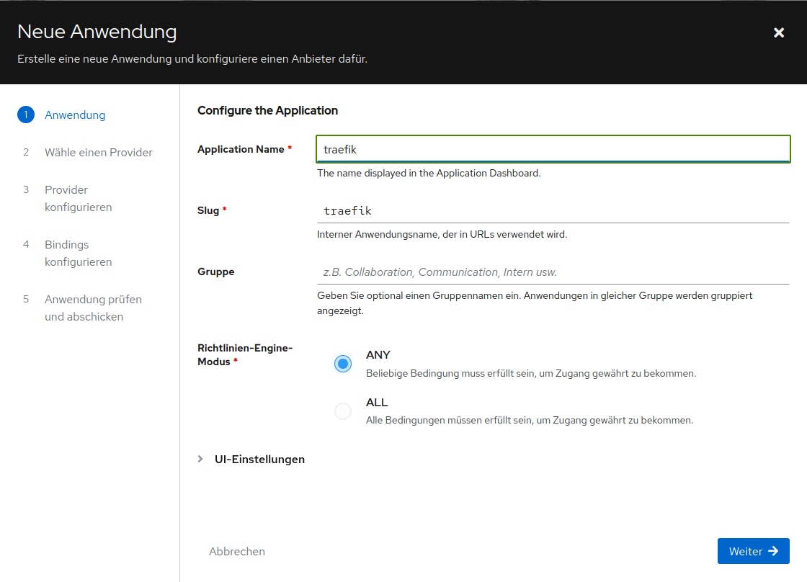
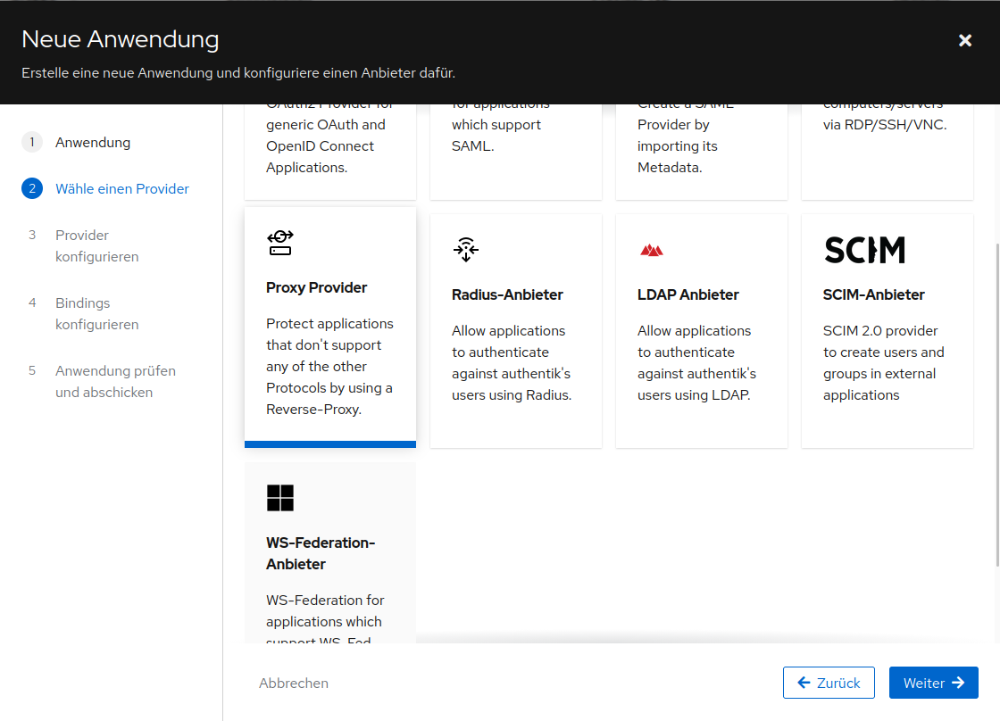
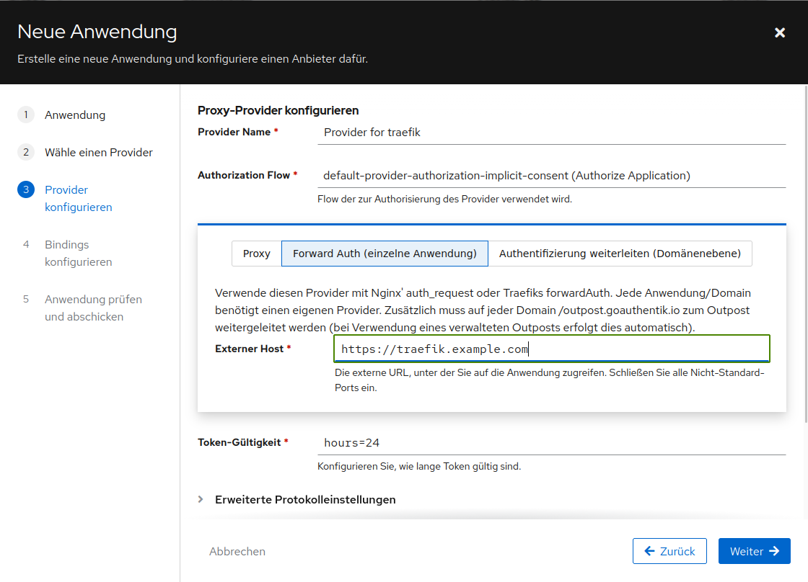
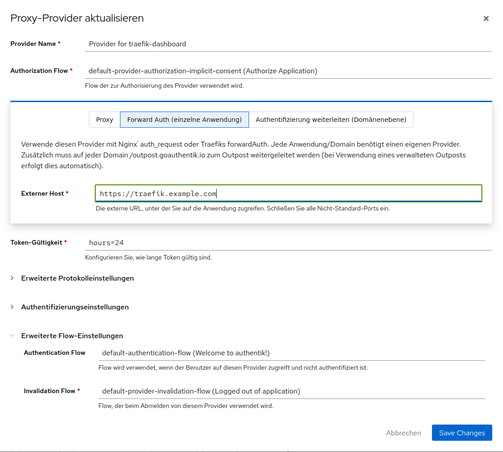
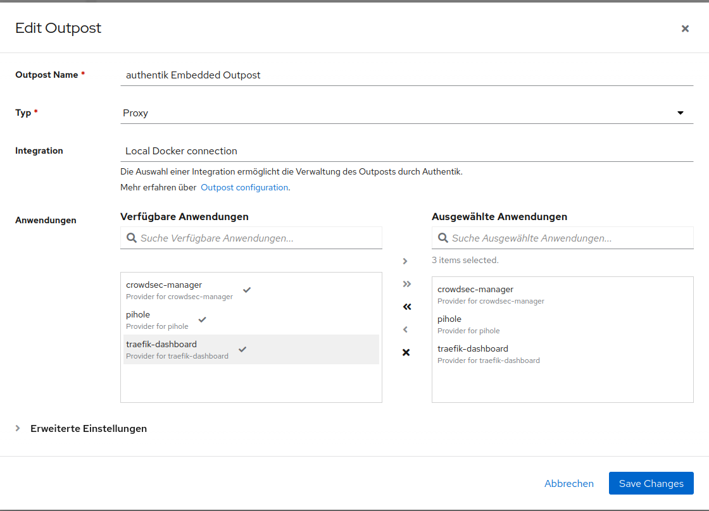

# Traefik, Authentik und CrowdSec

Ein lokaler Docker-Compose-Stack für HTTPS-Routing, zentrale Anmeldung und Schutz vor unerwünschtem Webverkehr.

Light-Version des Stacks ohne Authentik und Crowdsec-Manager und mit http-basic-auth [happylippo/traefik-crowdsec](https://github.com/happylippo/traefik-crowdsec)


## Funktionsweise des Stacks

Die Grafik zeigt den Weg einer Anfrage: Traefik übernimmt TLS und Routing. Geschützte Routen prüfen die Anmeldung über Authentik. CrowdSec wertet Traefik-Logs aus und liefert Entscheidungen an den Bouncer zurück. Getrennte Socket-Proxys begrenzen den internen Zugriff auf die Docker-API.

<p align="center">
  
</p>

## Komponenten

| Komponente | Aufgabe |
| --- | --- |
| Traefik | HTTPS-Routing über TCP/UDP 443, Docker- und Dateiprovider, Authentik-Forward-Auth und CrowdSec-Bouncer |
| Authentik | Identity Provider mit Server, Worker und PostgreSQL |
| CrowdSec | Erkennung und Abwehr anhand von Traefik-Logs, einschließlich AppSec/WAF |
| CrowdSec Manager | Weboberfläche zur Verwaltung von CrowdSec |
| Socket-Proxys | Getrennte Docker-API-Zugänge für Traefik/CrowdSec, Authentik und CrowdSec Manager |

Die Compose-Konfiguration liegt in `compose/` und wird über [`docker-compose.yml`](docker-compose.yml) zusammengeführt.

## Voraussetzungen

- Docker Engine und Docker Compose v2 mit Unterstützung für Compose `include`
- Bash, OpenSSL und Python 3
- `curl`, falls Cloudflare-IP-Netze für Forwarded Headers aktiviert werden
- Zugriff des aktuellen Benutzers auf den Docker-Daemon
- Freie Ports 443/TCP und 443/UDP auf dem Host
- IPv6-Unterstützung für Docker-Bridge-Netzwerke

Die Erstinstallation benötigt eine interaktive Konsole. Sie richtet die Konfiguration ein und startet die Container.

## Schnellstart

Im Projektverzeichnis ausführen:

```bash
./first_install.sh
```

Das Skript erstellt `.env`, falls die Datei noch fehlt, und fragt anschließend folgende Werte ab. Eine leere Eingabe übernimmt den angezeigten Vorgabewert:

1. Zertifikatresolver: `cloudflare_resolver`, `desec_resolver` oder `letsencrypt`
2. E-Mail-Adresse für ACME-Zertifikate
3. Zertifikatsdomain und Wildcard-Domain
4. Authentik-, Traefik- und CrowdSec-Manager-Hostname
5. CrowdSec-AllowList: IP-Adressen und CIDR-Netze, die CrowdSec dauerhaft zulassen soll
6. CAPTCHA-Provider für CrowdSec (`hcaptcha`, `recaptcha`, `turnstile` oder deaktiviert); bei Auswahl eines Providers fragt das Skript Site-Key und Secret-Key ab
7. ob Cloudflare-Proxy-IP-Netze als vertrauenswürdige Forwarded Headers gelten sollen
8. Cloudflare- oder deSEC-API-Token, wenn der entsprechende DNS-Resolver gewählt wurde

API-Tokens und der CAPTCHA-Secret-Key werden verdeckt eingelesen; CAPTCHA-Provider, Site-Key und Secret-Key stehen in `.env`, die mit Dateirechten `600` geschützt ist. Der Site-Key wird sichtbar, der Secret-Key verdeckt eingelesen. Bereits vorhandene Werte und lokale Konfigurationsdateien bleiben erhalten. Das Setup erzeugt fehlende Schlüssel und Vorlagen, übernimmt die CAPTCHA-Einstellungen in die CrowdSec-Traefik-Konfiguration, registriert den Traefik-Bouncer bei CrowdSec und startet anschließend den Stack.

Wenn du die Cloudflare-Proxy-Netze aktivierst, lädt das Skript die aktuellen
IPv4- und IPv6-Präfixe von [Cloudflare IPv4](https://www.cloudflare.com/ips-v4)
und [Cloudflare IPv6](https://www.cloudflare.com/ips-v6) und trägt sie in
`entryPoints.websecure.forwardedHeaders.trustedIPs` in
`data/traefik/traefik.yml` ein. Ohne Aktivierung bleibt die
Platzhalterkommentierung unverändert.

Die Vorgaben `auth.localhost` und `traefik.localhost` sind für den Zugriff vom Docker-Host aus gedacht. Sie stellen keine öffentlich gültigen TLS-Domains dar. Für öffentliche Hostnamen müssen die DNS-Einträge auf den Docker-Host zeigen und die gewählten Zertifikatsdaten zu diesen Hostnamen passen.

### Zertifikatsresolver

- **Cloudflare** und **deSEC** verwenden DNS-Challenges und können Wildcard-Zertifikate ausstellen. Der Cloudflare-Token benötigt laut [Vorlage](data/traefik/.env.sample) `Zone:DNS:Edit` und `Zone:Zone:Read`.
- **Let's Encrypt** verwendet in der mitgelieferten Traefik-Konfiguration eine TLS-ALPN-Challenge. Diese kann keine Wildcard-Zertifikate ausstellen. Die Standardrouter fordern ein Wildcard-SAN an; für die Standardkonfiguration daher Cloudflare oder deSEC auswählen. Für Let's Encrypt müssen die Zertifikatslabels in den Compose-Dateien passend zu den einzelnen Hosts angepasst werden.

Nach der Installation sind Authentik und das Traefik-Dashboard unter den gewählten Hostnamen erreichbar. Bei lokalen oder noch nicht korrekt konfigurierten Zertifikaten zeigt der Browser eine Zertifikatswarnung.

## Authentik erstmals einrichten und Traefik-Dashboard schützen

### Admin-Konto initialisieren

1. Öffne `https://<AUTHENTIK_HOST>/if/flow/initial-setup/`. Ersetze
   `<AUTHENTIK_HOST>` durch den in `.env` eingetragenen Hostnamen, zum Beispiel
   `auth.example.com`. Achte auf den abschließenden Schrägstrich.
2. Folge dem Einrichtungsdialog und setze ein Passwort für das Administratorkonto
   `akadmin`.
3. Melde dich mit diesem Konto an und öffne die Admin-Oberfläche.

Falls der Einrichtungsdialog nicht erscheint, prüfe, ob `authentik-server`,
`authentik-worker` und `postgresql` laufen. Authentik beschreibt den Ablauf in
seinen [ersten Schritten](https://docs.goauthentik.io/install-config/first-steps/).

### Anwendung „Traefik Dashboard“ mit Forward Auth anlegen

Die Screenshots zeigen die Einrichtung in Authentik. Die angezeigten Namen und
Slugs sind Beispiele; verwende in deiner Installation konsistente Werte.

1. Gehe in der Admin-Oberfläche zu **Applications > Applications** und wähle
   **New Application**.

   <p align="center">
     
     <br>
     <em>Abbildung 1: Anwendungsname und Slug festlegen.</em>
   </p>

2. Vergib den Namen **Traefik Dashboard** und einen Slug, zum Beispiel
   `traefik-dashboard`, dann **Next**.
3. Wähle als Provider-Typ **Proxy Provider**, dann **Next**.

   <p align="center">
     
     <br>
     <em>Abbildung 2: Den Proxy Provider auswählen.</em>
   </p>

4. Vergib einen Providernamen, lasse die voreingestellten Flows zunächst
   ausgewählt und stelle den Modus auf **Forward auth (single application)**.

   <p align="center">
     
     <br>
     <em>Abbildung 3: „Forward Auth (einzelne Anwendung)“ auswählen.</em>
   </p>

5. Trage als **External host** die vollständige Dashboard-URL ein, zum Beispiel
   `https://traefik.example.com`. Sie muss exakt zum Wert von `TRAEFIK_HOST` in
   `.env` passen.

   <p align="center">
     
     <br>
     <em>Abbildung 4: Die externe URL des Traefik-Dashboards eintragen.</em>
   </p>

6. Prüfe die Zusammenfassung und wähle **Create Application**.
7. Gehe zu **Applications > Outposts**, bearbeite den
   **authentik Embedded Outpost** und füge unter **Applications** die Anwendung
   **Traefik Dashboard** hinzu. Speichere die Änderung.

   <p align="center">
     
     <br>
     <em>Abbildung 5: Die Anwendung dem Embedded Outpost zuweisen.</em>
   </p>

Der Stack enthält bereits die Traefik-Middleware `authentik@file` und eine
separate Route für `/outpost.goauthentik.io/`. Öffne danach
`https://<TRAEFIK_HOST>`: Nicht angemeldete Nutzer werden zum Authentik-Login
weitergeleitet und nach erfolgreicher Anmeldung zum Dashboard zurückgebracht.
Die Dashboard-Route ist zusätzlich auf die in
`data/traefik/dynamic_conf/lan-only.yml` erlaubten Netze beschränkt. Passe diese
Liste an, wenn dein Client-Netz nicht enthalten ist.

Der **CrowdSec Manager** verwendet einen anderen Hostnamen. Lege für ihn eine
zweite Anwendung mit einem eigenen **Forward auth (single application)**-
Provider an und verwende als External host `https://<CROWDSEC_MANAGER_HOST>`.
Weise auch diese Anwendung dem Embedded Outpost zu.

Die Authentik-Dokumentation erläutert das Erstellen von
[Proxy-Providern](https://docs.goauthentik.io/add-secure-apps/providers/proxy/create-proxy-provider/)
und die [Forward-Auth-Modi](https://docs.goauthentik.io/add-secure-apps/providers/proxy/forward_auth/).

## Authentik-Docker-Integration

Der Authentik-Worker ist mit einem eigenen internen Socket-Proxy verbunden. Damit Authentik Docker-Outposts darüber verwalten kann:

1. In Authentik eine Docker-Integration beziehungsweise Docker-Serviceverbindung anlegen.
2. Als URL `http://socket-proxy-authentik:2375` eintragen.
3. Die Verbindung beim gewünschten Docker-Outpost auswählen.

Authentik erwartet für diese Verbindung eine HTTP-URL. Siehe die [Authentik-Dokumentation zur Docker-Integration](https://docs.goauthentik.io/add-secure-apps/outposts/integrations/docker/).

Der Authentik-Proxy erlaubt Schreibzugriffe auf die Docker-Container-API, die für das Erstellen und Entfernen von Outpost-Containern benötigt werden. Andere API-Bereiche wie `exec` und Netzwerkverwaltung sind gesperrt. Trotzdem ist Docker-Containerverwaltung privilegiert: Ein entsprechend berechtigter Container kann weitreichende Änderungen am Docker-Host auslösen.

Der CrowdSec Manager erhält über seinen eigenen Proxy Zugriff auf Container-Logs (`ALLOW_LOGS`) und weitreichende Docker-Rechte einschließlich `exec`. Behandle ihn als privilegierten Dienst. Beide Proxys sind intern erreichbar und veröffentlichen keinen Host-Port.

## Netzwerk und Adressen

Die Subnetze und festen Containeradressen stehen in `.env`:

| Netzwerk | Standard-IPv4 | Standard-IPv6 |
| --- | --- | --- |
| `authentik_internal` | `172.31.0.0/24` | `fd00:1:be:d::/64` |
| `crowdsec` | `172.31.64.0/24` | `fd00:1:be:b::/64` |
| `proxy` | `172.31.128.0/24` | `fd00:1:be:a::/64` |
| `socket_proxy` | `172.31.192.0/24` | `fd00:1:be:c::/64` |
| `crowdsec_manager_socket_proxy` | `172.31.193.0/24` | `fd00:1:be:e::/64` |
| `authentik_socket_proxy` | `172.31.194.0/24` | `fd00:1:be:f::/64` |

Wenn du ein Subnetz änderst, passe auch alle festen Containeradressen im selben Netz an. Bei Änderungen an `PROXY_NETWORK_SUBNET` oder `PROXY_NETWORK_IPV6_SUBNET` muss außerdem `AUTHENTIK_LISTEN__TRUSTED_PROXY_CIDRS` in `.env` die Traefik-Netzbereiche enthalten.

## Weitere Dienste über Traefik veröffentlichen

Verbinde einen Dienst mit dem Compose-Netzwerk `proxy`, aktiviere Traefik und weise ihm bei Bedarf die Middleware `authentik@file` zu. Der Dienst muss auf dem Port erreichbar sein, den du in den Traefik-Labels angibst.

Beispiel für einen separaten Compose-Stack:

```yaml
services:
  app:
    image: example/app:latest
    networks:
      - proxy
    labels:
      traefik.enable: "true"
      traefik.docker.network: proxy
      traefik.http.routers.app.rule: "Host(`app.example.com`)"
      traefik.http.routers.app.entrypoints: websecure
      traefik.http.routers.app.tls: "true"
      traefik.http.routers.app.middlewares: authentik@file
      traefik.http.services.app.loadbalancer.server.port: "8080"

networks:
  proxy:
    external: true
    name: proxy
```

Wenn `PROXY_NETWORK_NAME` in `.env` geändert wurde, trage diesen Netzwerknamen auch unter `networks.proxy.name` und im Label `traefik.docker.network` ein. Die Authentik-Middleware ist nicht global aktiviert, damit die Anmeldeseite nicht in eine Weiterleitungsschleife gerät.

## Verwaltung

`scripts/compose.sh` lädt die Root-Compose-Datei und `.env` automatisch:

```bash
# Status der Container
./scripts/compose.sh ps

# Logs aller Dienste oder eines bestimmten Dienstes
./scripts/compose.sh logs -f
./scripts/compose.sh logs -f traefik

# Konfiguration nach Änderungen anwenden
./scripts/compose.sh up -d

# Container stoppen und Netzwerke entfernen
./scripts/compose.sh down
```

`down` löscht weder das benannte PostgreSQL-Volume noch die lokalen Konfigurations- und Datenverzeichnisse. Für Backups sichere mindestens `.env`, `data/` und das Compose-Volume `authentik_database`. Entferne diese Daten nur, wenn du den Stack vollständig zurücksetzen möchtest.

## Verzeichnisübersicht

```text
compose/                  Compose-Fragmente für Dienste und Netzwerke
data/crowdsec/            CrowdSec-Vorlagen und Laufzeitdaten
data/traefik/             Traefik-Konfiguration, Zertifikate und Logs
data/authentik/           Authentik-Medien, Zertifikate und Templates
scripts/                  Setup- und Compose-Hilfsskripte
docker-compose.yml        Root-Datei, die die Fragmente zusammenführt
first_install.sh          Interaktive Erstinstallation
```

## CrowdSec-AllowList

Während `./first_install.sh` kannst du IP-Adressen und CIDR-Netze eingeben,
die CrowdSec dauerhaft zulassen soll. Trenne mehrere Werte durch Kommas,
Semikolons oder Leerzeichen, zum Beispiel `192.168.1.10, 2001:db8::5;
10.0.0.0/8`. Leere Eingabe ist erlaubt. IPv4 und IPv6 werden geprüft; CIDR-Netze
müssen kanonisch angegeben werden. Die Werte werden in
`data/crowdsec/allowlist.txt` gespeichert und beim Setup in die zentrale
CrowdSec-AllowList `installer_trusted_ips` übernommen. CrowdSec speichert diese
AllowList in seiner persistent eingebundenen Datenbank; wiederholtes Setup fügt
bereits vorhandene Einträge nicht erneut hinzu. Die Funktion benötigt CrowdSec
1.6.8 oder neuer.

Trage außerdem mindestens die IP-Adresse des Clients in die AllowList ein,
von dem aus du in Authentik Anwendungen anlegst. Andernfalls kann CrowdSec
Anfragen von diesem Client blockieren. Bereits erstellte Entscheidungen
(Decisions) für diese IP lassen sich anschließend im CrowdSec Manager löschen.

Alternativ kann auch `tx.allowed_methods=GET HEAD POST OPTIONS` für Authentik und 
Crowdsec-Manager erweitert werden. Erstelle dazu die Datei 
`data/crowdsec/data/crs-plugins/authentik/authentik-before.conf` und passe die URLs an.

```conf
# Authentik - Anwendungen erstellen und löschen
SecRule SERVER_NAME "@streq authentik.example.de" \
    "id:9901001,\
    phase:1,\
    pass,\
    nolog,\
    setvar:'tx.allowed_methods=GET HEAD POST OPTIONS PUT DELETE'"

# CrowdSec Manager - Decisions löschen
SecRule SERVER_NAME "@streq crowdsec.example.de" \
    "id:9901002,\
    phase:1,\
    pass,\
    nolog,\
    setvar:'tx.allowed_methods=GET HEAD POST OPTIONS DELETE'"
```

## CrowdSec AppSec: HTTP/3 erlauben

Der Stack enthält eine eigene CRS-Plugin-Regel, die HTTP/3 in der vorhandenen
Protokollprüfung zulässt. Das Installationsskript kopiert
`data/crowdsec/crs-plugins/custom/http-version-before.conf` bei der Einrichtung
nach `data/crowdsec/data/crs-plugins/custom/http-version-before.conf`.
Dieses Ziel liegt im persistenten Datenverzeichnis, das Compose nach
`/var/lib/crowdsec/data` einbindet. Vorhandene lokale Plugin-Dateien werden
vom Setup nicht überschrieben.

Die Regel `900230` setzt `tx.allowed_http_versions` auf
`HTTP/1.0 HTTP/1.1 HTTP/2 HTTP/2.0 HTTP/3 HTTP/3.0`. Sie wird über den
CRS-Wildcard-Include für `*-before.conf` vor
`REQUEST-901-INITIALIZATION.conf` geladen. Dadurch bleibt die CRS-Regel
`920430` aktiv und prüft weiterhin Protokollversionen. Voraussetzung ist,
dass die CrowdSec CRS-Konfiguration die Wildcards
`crs-plugins/*/*-config.conf` und `crs-plugins/*/*-before.conf` enthält.

Nach einem Update des Repositorys kann die Installation mit
`./scripts/setup.sh` aktualisiert werden; eine bereits angepasste lokale
Plugin-Datei bleibt dabei erhalten. Anschließend CrowdSec neu starten, damit
AppSec die Datei neu lädt.

## Weiterführende Links

- [Traefik-Dokumentation](https://doc.traefik.io/traefik/)
- [Authentik-Dokumentation](https://docs.goauthentik.io/)
- [CrowdSec-Dokumentation](https://docs.crowdsec.net/)
- [Ausgangsprojekt: traefik-crowdsec-stack](https://github.com/happylippo/traefik-crowdsec-stack)
